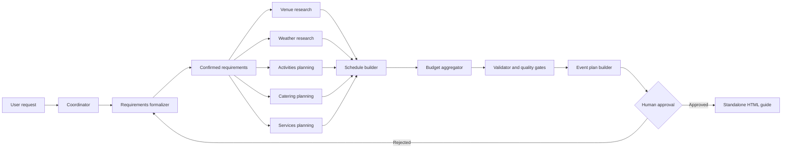

# Claude Agentic Workflow

> A reliable, resumable Event Planner workflow for Claude Code.

This repository contains the implementation brief and project foundation for a model-driven agentic workflow. The workflow is designed to turn a natural-language event request into a researched, validated, human-approved event plan.

[Read the full implementation brief](docs/PRACTICAL_TASK.md) · [View the Definition of Done](docs/PRACTICAL_TASK.md#16-definition-of-done)

> **Project status:** the repository brief and documentation foundation are prepared. The workflow implementation is the next project phase and must follow the requirements in [`docs/PRACTICAL_TASK.md`](docs/PRACTICAL_TASK.md).

## Contents

- [What this project does](#what-this-project-does)
- [At a glance](#at-a-glance)
- [Workflow architecture](#workflow-architecture)
- [Agent topology](#agent-topology)
- [Core guarantees](#core-guarantees)
- [Getting started](#getting-started)
- [Repository layout](#repository-layout)
- [Implementation roadmap](#implementation-roadmap)
- [Security](#security)
- [Definition of Done](#definition-of-done)

## What this project does

The target system acts as an intelligent event-planning team coordinated by a central workflow controller. It gathers the user's requirements, delegates focused research and planning tasks to specialized subagents, validates their artifacts, and assembles the results into a clear final guide.

The selected domain is **Event Planner**. The workflow can account for:

- occasion, atmosphere, and event format;
- date, duration, location, and venue requirements;
- guests, budget, currency, and spending priorities;
- catering, dietary restrictions, and beverages;
- activities, schedule, and required services;
- accessibility, parking, transport, and technology constraints;
- weather risks and contingency plans for outdoor events.

## At a glance

| Area | Target design |
|---|---|
| Domain | Event Planner |
| Claude Code entry point | `/plan-event` |
| Intermediate artifacts | Human-readable Markdown |
| Final deliverables | Event plan in Markdown and standalone HTML |
| Workflow state | `.workflow/runs/<run-id>/workflow-state.json` |
| External research | Web search plus a community or custom MCP server |
| Approval model | Explicit, deterministic human approval |
| Failure handling | Named quality gates and targeted retries, maximum three attempts |
| Recovery | Resume from persisted state without repeating valid work |

The `/plan-event` command is the target command defined by the brief. It becomes runnable after the workflow implementation is completed.

## Workflow architecture



Independent research branches should run in parallel. Dependent work must wait for its required inputs. If a quality gate fails, only the affected branch and its downstream artifacts are regenerated.

## Agent topology

Each subagent has one responsibility and owns one primary artifact.

| Agent | Responsibility | Artifact |
|---|---|---|
| `requirements-formalizer` | Capture, clarify, and confirm the event requirements. | `requirements.md` |
| `venue-researcher` | Find venues matching location, capacity, budget, accessibility, and event constraints. | `venues.md` |
| `weather-researcher` | Research weather risks and outdoor-event contingencies. | `weather.md` |
| `activities-planner` | Find or design suitable activities with duration, cost, and source links. | `activities.md` |
| `catering-planner` | Plan menus and catering that match guest and dietary requirements. | `catering.md` |
| `services-planner` | Plan vendors and services such as music, decoration, photography, equipment, or security. | `services.md` |
| `schedule-builder` | Assemble a feasible event timeline without conflicts. | `schedule.md` |
| `budget-aggregator` | Aggregate costs, assumptions, currency, and contingency. | `budget.md` |
| `validator` | Apply quality gates and report findings. | `validation-report.md` |
| `event-plan-builder` | Synthesize the validated artifacts into one event plan. | `event-plan.md` |
| `html-builder` | Render the approved plan as a standalone HTML guide. | `event-plan.html` |

The coordinator owns orchestration only. It must not invent or write the event-planning content itself.

## Core guarantees

### Requirement confirmation

The workflow must identify missing information, ask focused questions, formalize the answers, and obtain confirmation before planning begins.

### External research

Recommendations must be based on external sources. Every venue, vendor, activity, restaurant, or service recommendation must include a real source URL and clearly marked assumptions.

### Quality gates

The validator checks, among other things:

- total budget and contingency remain within the approved limit;
- venue matches the guest count, location, accessibility, parking, and event type;
- schedule is feasible and contains no unexplained overlaps;
- catering satisfies dietary and guest requirements;
- required services are included and costed;
- outdoor events have weather information and a contingency plan;
- recommendations are not duplicated and have valid source links.

### Targeted recovery

A failed gate is mapped to the responsible agent. The workflow reruns only the affected work and downstream artifacts, up to three attempts. Unresolved failures block dependent work and are reported clearly.

### Human approval

The final HTML write is protected until the current event-plan version has received explicit approval. Rejected plans enter a revision loop and must pass validation again before approval is requested.

### Persistent state

Every run records its requirements, plan, agent statuses, artifacts, dependencies, quality-gate results, retries, approval state, and final output. A resumed run continues from the persisted state instead of repeating valid completed work.

## Getting started

### 1. Read the brief

Open [`docs/PRACTICAL_TASK.md`](docs/PRACTICAL_TASK.md). It is the authoritative, self-contained assignment and replaces the original PDF.

### 2. Start Claude Code in the repository

Open Claude Code from the repository root and provide the brief as context. The following prompt is sufficient:

```text
Read docs/PRACTICAL_TASK.md completely and treat it as the authoritative implementation brief. Inspect the repository and available Claude Code capabilities, then implement the workflow described there. Do not ask me to repeat the assignment. Preserve existing work, verify each implementation phase, and report how to run and resume the workflow when finished.
```

### 3. Configure prerequisites

Before running the completed workflow, configure the prerequisites documented by the implementation, including:

- Claude Code and the required runtime;
- the selected MCP server;
- any required environment variables or API keys, supplied locally and never committed;
- the web-search capability used by the research agents.

### 4. Run the target command

After implementation, invoke the workflow with a request such as:

```text
/plan-event Plan a one-day indoor family birthday event for 20 guests. Use a fixed budget, include children-friendly activities and catering, and recommend suitable venues and services in the requested location.
```

The workflow should ask for missing details, show the confirmed requirements, execute the dependency-aware plan, validate the artifacts, request approval, and create the final guide only after approval.

### 5. Resume an interrupted run

Use the workflow's documented resume command or procedure with the run ID. The coordinator must load:

```text
.workflow/runs/<run-id>/workflow-state.json
```

It must reuse valid completed artifacts and continue only pending, failed, or invalidated work.

## Repository layout

### Current foundation

```text
.
├── .gitignore
├── README.md
└── docs/
    └── PRACTICAL_TASK.md
```

### Target implementation layout

```text
.
├── CLAUDE.md
├── README.md
├── .gitignore
├── docs/
│   └── PRACTICAL_TASK.md
├── .claude/
│   ├── commands/
│   │   └── plan-event.md
│   ├── agents/
│   ├── skills/
│   ├── hooks/
│   └── mcp/
└── .workflow/
    └── runs/
        ├── run-001/
        ├── run-002/
        └── run-003/
```

The exact Claude Code configuration paths may follow the installed version, but the responsibilities, artifacts, hooks, skills, MCP integration, and persisted state must remain equivalent to the brief.

## Implementation roadmap

| Phase | Outcome |
|---|---|
| 1. Scaffold | Repository conventions, command boundary, artifact directories, and state model |
| 2. Requirements | Clarification loop, confirmation, and dependency-aware execution plan |
| 3. Domain agents | Venue, weather, activities, catering, services, schedule, and budget branches |
| 4. Reliability | Skills, MCP integration, hooks, quality gates, and targeted retries |
| 5. Synthesis | Validated event plan, deterministic approval loop, and HTML rendering |
| 6. Evidence | Three complete sample runs, resume demonstrations, and final documentation |
| 7. Verification | Tests, linting, build checks, clean-checkout verification, and secret review |

## Security

- Never commit API keys, credentials, tokens, or private personal data.
- Keep local secrets in environment variables or ignored `.env` files.
- Do not write secrets into workflow state, logs, artifacts, or user-facing messages.
- Mark estimates and unconfirmed availability clearly.
- Use only safe, synthetic data in demonstration runs.

The repository `.gitignore` excludes macOS metadata and local environment files while allowing a safe `.env.example` to be committed.

## Definition of Done

The complete checklist is maintained in [`docs/PRACTICAL_TASK.md#16-definition-of-done`](docs/PRACTICAL_TASK.md#16-definition-of-done). The implementation is complete only when it includes:

- a coordinator and at least five used subagents;
- two used reusable skills;
- both `PreToolUse` and `PostToolUse` hooks;
- an integrated and exercised MCP server plus external web search;
- consistent artifacts and named quality gates;
- targeted retries with a maximum of three attempts;
- persisted state and resume support;
- deterministic approval before final HTML generation;
- three complete demonstration runs;
- setup, run, resume, verification, and secret configuration instructions;
- no committed credentials or API keys.

## Related documentation

- [Full practical task brief](docs/PRACTICAL_TASK.md)
- [Definition of Done](docs/PRACTICAL_TASK.md#16-definition-of-done)
- [Implementation sequence](docs/PRACTICAL_TASK.md#15-implementation-sequence)
- [Workflow state and resume](docs/PRACTICAL_TASK.md#9-workflow-state-and-resume)
