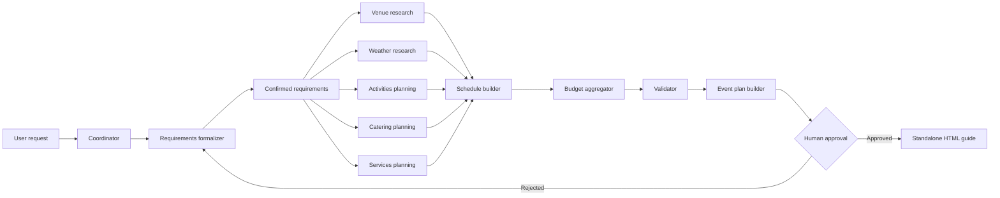

# Commands

## `/plan-event`

[`.claude/commands/plan-event.md`](../.claude/commands/plan-event.md) is the single entry point.
The session running it acts as the **coordinator**: it owns `.workflow/runs/<run-id>/workflow-state.json`,
decides which subagents run and when, enforces quality gates and retries, and gates the final HTML
behind an explicit approval. It never authors event-planning content itself — see
[`AGENTS.md`](AGENTS.md) for who does.

### Flow

1. **Resume check** — if a run for this request already exists and is unfinished, the coordinator
   asks whether to resume it or start fresh; otherwise it creates
   `.workflow/runs/run-<NNN>/{artifacts,output,logs}` and an initial `workflow-state.json`.
2. **Requirements** — `requirements-formalizer` asks any missing clarification questions, writes
   `requirements.md`, and waits for the literal reply `CONFIRM` before anything else starts.
3. **Dynamic, dependency-aware plan** — the coordinator decides which research branches apply
   (weather only for outdoor/weather-sensitive events) and writes `execution_plan` into state.
4. **Parallel research** — all applicable branches (`venue-researcher`, `weather-researcher`,
   `activities-planner`, `catering-planner`, `services-planner`) are dispatched together.
5. **Sequential synthesis** — `schedule-builder` → `budget-aggregator` → `validator`.
6. **Targeted retry** — any failed gate is routed to the one responsible agent (plus genuinely
   affected downstream agents), re-validated, up to 3 attempts before being reported `blocked`.
7. **Approval** — `event-plan-builder` produces `event-plan.md` with a version + SHA-256 hash; the
   coordinator shows the summary and asks for the exact token `APPROVE`. Anything else is a
   rejection that starts a revision loop.
8. **Final HTML** — `html-builder` renders `output/event-plan.html`, guarded by the
   `approval-gate-guard` hook (see [`HOOKS.md`](HOOKS.md)).

### Resuming a run

Reference the run ID (e.g. "resume run-003"). The coordinator loads
`.workflow/runs/<run-id>/workflow-state.json` first, reuses every artifact already `completed`
with a passing quality gate, and continues only `pending`/`failed`/`blocked` work. A real worked
example is in [`RUNS.md`](RUNS.md#run-003) and `.workflow/runs/run-003/logs/interruption-note.md` /
`resume-log.md`.

### Approval token

Only the exact string `APPROVE`, sent in reply to the currently displayed version/hash, counts as
approval. Any other reply — including partial agreement or silence — is treated as **not
approved** and starts a revision loop. This is enforced at the tool-call level by
`approval-gate-guard`, not just by instruction — see [`HOOKS.md`](HOOKS.md).
